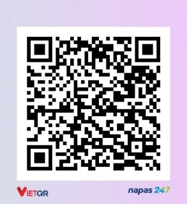

# Support Skill World ☕

Thank you for considering supporting Skill World. The most valuable support is still simple: **star the repository, share it, report issues, and contribute useful skills or improvements**.

If you would also like to support the time spent curating, reviewing, documenting, and expanding Skill World into new domains, you can use one of the options below.

## Vietnam QR support

Scan the QR code below with a supported Vietnamese banking app:



If the image does not render in your GitHub view, open [`QR.jpg`](./QR.jpg) directly.

## PayPal

[**paypal.me/kaistudio6886**](https://www.paypal.me/kaistudio6886)

## Buy Me a Coffee

**Not configured yet.**

Once an account is created, add it here in the form:

```text
https://www.buymeacoffee.com/<your-username>
```

## About sponsorship

Support is optional and does not change the open-source licensing of Skill World or the upstream licenses of imported third-party skills. Sponsorship does not buy influence over attribution, provenance, licensing, or security/quality decisions.

Thank you for helping Skill World grow from software-development skills into a broader collection for content creation, office productivity, and future professional domains.
